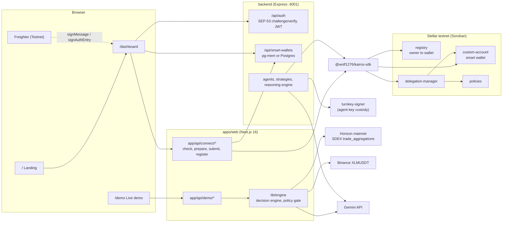

# Kairos Matrix

Kairos Matrix is the whole Kairos system in one pnpm workspace that runs locally: a marketing landing page, a live AI agent demo, the dashboard, the agents backend, the TypeScript SDK and the Soroban smart contracts, wired to **fresh contracts on Stellar testnet**.

Kairos is a non-custodial trading and yield system for Stellar. Users keep their funds in a smart wallet (a Soroban custom account). AI agents can only act through on-chain, policy-limited delegations, so the contracts, not the model, are the final authority over funds.

- **Landing page** at `/`, adapted from Kryon (see [Credits](#credits-and-licenses)).
- **Live demo** at `/demo`: three role agents (Strategic, Yield, Balancer) read live XLM/USDC market data, ask Gemini for a decision, and pass it through a deterministic policy gate into a paper portfolio.
- **Dashboard** at `/dashboard`: smart-wallet onboarding via a Stellar wallet (Freighter), agents, context layer.
- **Backend** on port 4001: wallet-signature auth, smart-wallet store, agents, strategy and reasoning engine, scheduler.
- **Contracts**: `delegation-manager`, `policies`, `custom-account`, `registry`.

## Architecture



Live data sources: Stellar **mainnet** Horizon (candles and the live trade stream), Binance (fallback and ticker cross-check), Gemini (decisions). Everything that touches contracts or wallets runs on **testnet**.

## Repository structure

```
kairos-matrix/
├── apps/web/                    Next.js 16 app (landing, demo, dashboard, API routes)
│   ├── app/landing/             Kryon-derived landing page (+ LICENSE-KRYON)
│   ├── app/api/demo/*           Demo API (status, market, portfolio, intent, cycle, reset, stream)
│   ├── app/api/connect/*        Smart-wallet onboarding (check, prepare, submit, register)
│   ├── app/dashboard/           Dashboard pages
│   ├── app/hooks, contexts, lib Wallet connect, auth, SDK wrappers
│   ├── lib/engine/              Demo decision engine, strategies, intent parser
│   └── public/demo, landing     Static demo page, landing assets
├── backend/                     Express agents backend (port 4001)
│   ├── src/                     auth, smart wallets, agents, reasoning, strategies, runtime
│   └── demo/                    Standalone live demo server (pnpm demo:live)
├── packages/
│   ├── sdk/                     @wolf1276/kairos-sdk (wallet, registry, delegations)
│   ├── types/                   @kairos/types
│   └── turnkey-signer/          Turnkey MPC signer used by the backend
├── contracts/soroban/           Rust workspace: delegation-manager, policies, custom-account, registry
├── configs/
│   ├── contracts.testnet.json   Contract IDs + custom-account wasm hash (fresh deploy)
│   ├── deployment.testnet.json  Deployer public key + deploy transaction hashes
│   └── contracts.mainnet.json   Carried over from Kairos, not used here
├── scripts/
│   ├── deploy-testnet.ts        Build and deploy every contract to testnet
│   └── e2e-smart-wallet.ts      Browser-equivalent onboarding test with a throwaway key
├── docs/                        Docs carried over from Kairos (see note below)
└── pnpm-workspace.yaml
```

`docs/` was copied from the original Kairos repo. Some links inside those files point at documents that are not part of this repo (for example `docs/architecture/*`). `docs/AI_PIPELINE.md` is a placeholder in the source too. `docs/KAIROS_README.md` is the original Kairos README.

## Prerequisites

| Tool | Version | Needed for |
| --- | --- | --- |
| Node.js | 20+ (tested on 24) | everything |
| pnpm | 10 (`packageManager` pins 10.33.2) | workspace |
| Rust + `wasm32v1-none` target | stable | building contracts (`rustup target add wasm32v1-none`) |
| Stellar CLI | 30.x | deploying contracts (`cargo install --locked stellar-cli`, or a release binary) |
| Freighter extension | current, **network set to Testnet** | the real browser connect flow |

The Rust toolchain and Stellar CLI are only needed to redeploy contracts. If you only want to run the app against the contracts already deployed (IDs below), `pnpm install` and `pnpm dev` are enough.

On Linux, `cargo install stellar-cli` needs `libudev-dev` (hidapi). Without it, download the prebuilt binary from <https://github.com/stellar/stellar-cli/releases> and put it on your `PATH`.

## Quick start

```bash
pnpm install

# 1. Environment (both files are gitignored)
cp backend/.env.example     backend/.env
cp apps/web/.env.example    apps/web/.env.local
#    Fill in the values described in "Environment variables" below.
#    Contract IDs come from configs/contracts.testnet.json.
#    Generate secrets:  openssl rand -hex 32   (AUTH_JWT_SECRET, AGENT_MASTER_KEY)
#    AUTH_JWT_SECRET must be identical in backend/.env and apps/web/.env.local.

# 2. Run backend + web together
pnpm dev
```

`pnpm dev` builds `packages/sdk` and `packages/turnkey-signer`, then runs the backend and the web app side by side with `concurrently`.

| Service | URL |
| --- | --- |
| Web (landing, demo, dashboard) | <http://localhost:3000> (default) |
| Backend | <http://localhost:4001> (`/health` returns `{"ok":true}`) |

The web port defaults to 3000. To use another one, set `WEB_PORT` and make the backend's `ALLOWED_ORIGIN` match:

```bash
# backend/.env       ALLOWED_ORIGIN=http://localhost:3000,http://localhost:3200
WEB_PORT=3200 pnpm dev
```

`PORT` is not used for the web app because the backend reads `PORT` too.

Minimal local setup, if you only want the landing page and demo: set `GEMINI_API_KEY` in `apps/web/.env.local`. The backend and chain variables are only needed for the dashboard and wallet onboarding.

## Environment variables

### Backend (`backend/.env`)

| Name | Required | Purpose |
| --- | --- | --- |
| `STELLAR_NETWORK` | yes | `testnet` (default) or `mainnet` |
| `DELEGATION_MANAGER_CONTRACT_ID` | yes | Delegation manager contract |
| `POLICY_CONTRACT_ID` | yes | Policies (caveat enforcer) contract |
| `CUSTOM_ACCOUNT_CONTRACT_ID` | yes | Reference custom-account instance |
| `CUSTOM_ACCOUNT_WASM_HASH` | yes | Wasm hash used to deploy per-user smart wallets |
| `REGISTRY_CONTRACT_ID` | yes | Owner to smart-wallet registry |
| `AUTH_JWT_SECRET` | yes | Signs session tokens after wallet-signature login. Same value as the web app. |
| `AGENT_MASTER_KEY` | yes | 64 hex chars. Decrypts legacy encrypted agent keys. |
| `ALLOWED_ORIGIN` | yes | Comma-separated CORS origins; must include the web origin (with port). Defaults to `http://localhost:3000`. |
| `PORT` | no | Default `4001` |
| `AGENTS_DB_PATH` | no | SQLite file for agents, default `./data/agents.db` |
| `DATABASE_URL` | no (dev) / yes (prod) | Postgres for smart-wallet ownership. **Leave unset locally**: the backend then uses an in-memory pg-mem store (rows vanish on restart; the on-chain registry still recovers them). With `NODE_ENV=production` it is mandatory. |
| `GEMINI_API_KEY`, `GEMINI_MODEL` | no | Gemini for intent parsing and decisions |
| `LLM_PROVIDER_ORDER` | no | Provider fallback chain, e.g. `gemini` |
| `TURNKEY_ORGANIZATION_ID`, `TURNKEY_CREDENTIALS_FILE` (or `TURNKEY_API_PUBLIC_KEY` / `TURNKEY_API_PRIVATE_KEY`) | agent creation only | Turnkey MPC custody for agent keys |
| `REASONING_PROVIDER`, `REASONING_MODEL`, `REASONING_*` | no | Reasoning engine provider and tuning (default provider `openrouter`) |
| `OPENROUTER_API_KEY`, `OPENAI_API_KEY`, `ANTHROPIC_API_KEY`, `DEEPSEEK_API_KEY`, `NVIDIA_API_KEY`, `OLLAMA_*` | no | Keys for the chosen reasoning provider |
| `SCHEDULER_INTERVAL_MS` | no | Agent tick interval, default 30000 |
| `DEV_ALLOWLIST` | no | Public keys allowed on `/api/dev/*` |
| `BLEND_*`, `SOROSWAP_*` | no | Protocol adapter contract IDs and RPC URLs |

`backend/.env.example` documents all of them.

### Web (`apps/web/.env.local`)

| Name | Required | Purpose |
| --- | --- | --- |
| `GEMINI_API_KEY` | for AI demo | Without it the demo agents use a deterministic heuristic (`llmModel: null`) |
| `GEMINI_MODEL` | no | Default `gemini-3.6-flash` (falls back to a lite model on 503) |
| `LLM_PROVIDER_ORDER` | no | Demo defaults to `gemini` |
| `MARKET_DATA_SOURCE` | no | Demo default `stellar-mainnet` |
| `NEXT_PUBLIC_AGENTS_BACKEND_URL` | dashboard | Backend URL used by the **browser**. Inlined at build time. |
| `AGENTS_BACKEND_URL` | dashboard | Backend URL used by Next API routes (server side) |
| `STELLAR_NETWORK` | dashboard | `testnet` |
| `DELEGATION_MANAGER_CONTRACT_ID`, `POLICY_CONTRACT_ID`, `CUSTOM_ACCOUNT_CONTRACT_ID`, `CUSTOM_ACCOUNT_WASM_HASH` | dashboard | Contract config used by the SDK in `/api/connect/*` |
| `REGISTRY_CONTRACT_ID` | dashboard | Registry. If unset, registry reads and writes become no-ops and the DB is the only record. |
| `FUNDER_SECRET_KEY` | dashboard | Funded **testnet** secret that sponsors wallet deployment and registry writes. Server side only. |
| `NEXT_PUBLIC_MAINNET_USDC_ISSUER`, `OPENROUTER_API_KEY`, `LLM_MOCK` | no | Optional |

`AUTH_JWT_SECRET` is only read by the backend, but keep one value per environment and do not commit it.

## Deployed testnet contracts

Fresh deployment on Stellar testnet, 2026-11-14. Deployer public key: `GBS3MEU3ELLTJQIFU7JJCCKPH6OB54QKOE5AUPEOXKRHNRJ3WNPPO3EK` (identity `kairos-matrix-deployer`; it is also the sponsor `FUNDER_SECRET_KEY` and the owner/admin of the manager and registry).

| Contract | ID | Deploy tx |
| --- | --- | --- |
| Delegation manager | [`CCUDV7K3AC2EY4FXFPEFKOML4VDPBVNYIRK6OTP42WTARM5PWSSJYNS4`](https://stellar.expert/explorer/testnet/contract/CCUDV7K3AC2EY4FXFPEFKOML4VDPBVNYIRK6OTP42WTARM5PWSSJYNS4) | [`c6170288…2272`](https://stellar.expert/explorer/testnet/tx/c6170288d034e81023399c68443695e783f5eae36437dc5656913e923e082272) |
| Policies | [`CBAPE23PHQO2BGWONAYCYTCJDNR2S3UXRKHWKZQQYEMFHJMP4AGLLZJJ`](https://stellar.expert/explorer/testnet/contract/CBAPE23PHQO2BGWONAYCYTCJDNR2S3UXRKHWKZQQYEMFHJMP4AGLLZJJ) | [`76ff0099…6b98`](https://stellar.expert/explorer/testnet/tx/76ff00991df875d40a3ace5ef397b85e25adf3684bdf694685b936622fdb6b98) |
| Custom account (reference instance) | [`CCBLVHSE3ABLEKL4W7JZ6YS5AWGUU7PKU5YJNTO2QUMG7H5MMOQ7LIHG`](https://stellar.expert/explorer/testnet/contract/CCBLVHSE3ABLEKL4W7JZ6YS5AWGUU7PKU5YJNTO2QUMG7H5MMOQ7LIHG) | [`5f22830b…3e07`](https://stellar.expert/explorer/testnet/tx/5f22830bb5413a0e6d0b7838b911798cf8aa397bf0c3363b5c29d8764e443e07) |
| Registry | [`CBSKOX23HCIKCVCUEYDVMJKX5TOIGTX6DEVLSD2UXOS3QDCH2HKVOQWG`](https://stellar.expert/explorer/testnet/contract/CBSKOX23HCIKCVCUEYDVMJKX5TOIGTX6DEVLSD2UXOS3QDCH2HKVOQWG) | [`29496d3e…5d01`](https://stellar.expert/explorer/testnet/tx/29496d3e0888cbd34ea4b52b18b0f1253b92756b9aadda059e79d04e7e815d01) |

| Item | Value |
| --- | --- |
| Custom account wasm hash | `4331eb59811ce18556ead7bff9b7bc1bb81c56cd9d29e629e2f406241b915b2d` |
| Wasm upload tx | [`322a1274…3820`](https://stellar.expert/explorer/testnet/tx/322a12747da800827f31c88fdcb8d059b1d87fc4218f034eb0ad244dacb93820) |
| `set_policies_contract` tx (links policies into the manager) | [`94600bd2…a11`](https://stellar.expert/explorer/testnet/tx/94600bd20b8029e2f2d9c40ea4ceaedd1c96fd084759124dd1a4bbbaa2869a11) |

All of this is machine-readable in `configs/contracts.testnet.json` and `configs/deployment.testnet.json`. Each contract was checked on chain (`stellar contract info interface`, plus read calls: manager `is_paused` is false, `get_policies_contract` returns the policies ID, registry `get_smart_wallet` works).

### Redeploying

```bash
stellar keys generate my-deployer --network testnet --fund    # once
DEPLOYER_ALIAS=my-deployer pnpm deploy:testnet                # default alias: kairos-matrix-deployer
```

The script builds the contracts, uploads the custom-account wasm, deploys manager, policies, custom account and registry (constructors run atomically in the deploy transaction), links the policies contract into the manager, and writes both JSON files. Then copy the new IDs and wasm hash into `backend/.env` and `apps/web/.env.local`, and set `FUNDER_SECRET_KEY` to the secret of the deployer identity (`stellar keys secret my-deployer`). Restart `pnpm dev`.

## Smart-wallet onboarding flow

What happens when a user clicks Connect on the dashboard:

1. **Connect Freighter.** `walletKit.ts` (Stellar Wallets Kit) opens the picker; the app reads the address. Freighter must be on **Testnet**.
2. **Sign-in signature.** The browser calls `POST {backend}/api/auth/challenge` with the public key and gets a message (`Kairos login\naddress: …\nnonce: …`). The wallet signs it with SEP-43/53 `signMessage` (signature over `SHA-256("Stellar Signed Message:\n" + message)`). `POST /api/auth/verify` checks the Ed25519 signature and returns a 7-day JWT. The token is kept in `sessionStorage`.
3. **Lookup.** The app checks the backend's smart-wallet store (`GET /api/smart-wallets`), then falls back to the on-chain registry. `POST /api/connect/check` does the same server side and never treats a registry error as "no wallet".
4. **Sponsored deploy, step 1.** For a new user, `POST /api/connect/prepare` funds the funder and owner accounts on testnet if needed and builds a `CreateContract` transaction for the custom-account wasm. It returns an unsigned Soroban authorization entry for the owner.
5. **Owner authorizes.** Freighter signs the auth entry (`signAuthEntry`). The funder pays the fees; the owner only authorizes the creation.
6. **Sponsored deploy, step 2.** `POST /api/connect/submit` submits the signed deploy, initializes the wallet with the owner, registers `owner → wallet` in the **registry** contract (funder-attested, and the registry contract cross-checks `wallet.owner()`), verifies the registry entry by reading it back, then saves the row in the backend DB.
7. **Recovery.** If something fails after the wallet exists on chain, the error carries the wallet address and `POST /api/connect/register` retries only the persistence and registry steps, so a retry can never create a second wallet.

### Automated end-to-end check

`scripts/e2e-smart-wallet.ts` performs exactly the steps above, with a freshly generated, friendbot-funded throwaway keypair in place of Freighter:

```bash
pnpm dev                                  # terminal 1
WEB_PORT=3200 pnpm e2e:smart-wallet       # terminal 2 (omit WEB_PORT if web is on 3000)
```

It checks: challenge and SEP-53 signature login, a wrong signature is rejected, `check` returns `new`, `prepare`, signing the auth entry the way Freighter does (signature over the SHA-256 of the HashIdPreimage), `submit`, the contract exists on testnet RPC, `owner()` equals the throwaway key, `GET /api/smart-wallets` returns it, the registry maps owner to wallet, `check` now returns `existing`, and `register` is idempotent. Overrides: `WEB_URL`, `BACKEND_URL`, `SOROBAN_RPC_URL`. It exits non-zero on any failure.

Each run creates a new real wallet on testnet. That is harmless but not free of side effects.

## Live demo (`/demo`)

1. Type an intent (for example "grow XLM, medium risk"). Gemini parses it into an agent spec.
2. Run a **decision cycle**. The three role agents each get live market context and propose an action:
   - Strategic: picks a strategy from the catalogue for the detected regime and says buy, sell or hold.
   - Yield: proposes moving idle cash to a yield venue.
   - Balancer: proposes rebalancing toward the target allocation.
3. The **policy gate** (deterministic code, not the model) enforces a per-risk-level minimum confidence, maximum trade size and drift band. At most one fill per cycle.
4. Approved trades fill a **paper portfolio** at the live price with 0.1% slippage.

Live: XLM/USDC candles from Stellar mainnet Horizon `trade_aggregations` (Binance fallback), the stream of real mainnet SDEX trades, the Binance XLMUSDT ticker every 5 s, indicators, regime detection, Gemini decisions.

Simulated: execution (paper only; no wallet, keys or transactions) and yield venue APYs (a static venue table). The yield agent is advisory.

Limits: 20 s cooldown between cycles (HTTP 429), 409 if a cycle is already running. Demo state (portfolio, SSE clients, trade stream) is an in-memory singleton: run one web instance.

Gemini quota: the free tier rate-limits and sometimes returns 503. When a call fails the engine retries, falls back to a lite model, and finally to the heuristic, reported as `llmModel: null` with "Heuristic (LLM unavailable)" in the reasoning text. A 429 is not a bug in the app.

The same demo also runs standalone from the backend: `pnpm demo:live` (default port 4100, change with `DEMO_PORT`).

## AI pipeline summary

Market data and indicators feed a regime classifier. The strategy engine proposes candidates from the strategy catalogue. The reasoning engine (config-driven provider: Gemini, OpenRouter, OpenAI, Anthropic, DeepSeek, NVIDIA, Ollama) turns that context into a structured decision. The decision is validated and checked against policy before any execution plan exists, then routed to execution adapters (Blend, Soroswap) behind the delegation and redemption path. Outcomes are recorded in the memory and learning layers. The model has no signing capability. See `docs/AI_PIPELINE.md` (a placeholder in the source repo) and `backend/src/reasoning/`.

## Security model

- **Non-custodial.** Funds live in the user's smart wallet. The user's key never leaves their wallet; the app only asks for message and auth-entry signatures.
- **AI is advisory.** LLM output is data. It is schema-validated, then filtered by a deterministic policy gate. A model failure degrades to a heuristic hold, never to an unchecked trade.
- **On-chain policy enforcement.** Agents act through delegations whose caveats are enforced by the `policies` contract, called by the `delegation-manager`. The manager only accepts the configured policies contract, which is why `deploy-testnet.ts` links it.
- **Authentication.** Wallet-signature login (SEP-53), 5-minute single-use challenge, HS256 JWT with the algorithm pinned. The backend derives the owner from the token, never from the request body.
- **Testnet only.** The funder key is a testnet key. Do not put a mainnet secret in `FUNDER_SECRET_KEY`.
- **Secrets are gitignored.** `.env`, `.env.*` (except `.env.example`), `secrets/`, Turnkey credential files and `backend/data/` are in `.gitignore`. Stellar CLI identities live in `~/.config/stellar`, outside the repo.
- The contracts in this repo have not been independently audited. Treat them as testnet software. See `docs/SECURITY.md` for the original threat model.

## Scripts

| Command | What it does |
| --- | --- |
| `pnpm dev` | Builds `sdk` and `turnkey-signer`, then runs backend (4001) and web (`WEB_PORT`, default 3000) with live reload |
| `pnpm build` | Builds packages, backend and the Next app |
| `pnpm start` | Runs the built backend and web app |
| `pnpm build:packages` | Builds `sdk` and `turnkey-signer` only |
| `pnpm deploy:testnet` | Builds and deploys all contracts to testnet, writes `configs/*.json` |
| `pnpm e2e:smart-wallet` | Smart-wallet onboarding end-to-end test (needs `pnpm dev` running) |
| `pnpm demo:live` | Standalone backend live demo (`DEMO_PORT`, default 4100) |
| `pnpm test` | SDK, backend and web unit tests |
| `pnpm --filter app e2e` | Playwright specs in `apps/web/e2e` (starts its own `next dev` on 3000) |

## Testing

```bash
pnpm test
```

Last run: SDK 47 passed, backend 1483 passed (27 skipped, 3 files skipped), web 37 passed (includes `app/api/connect/*` and `useSmartWallet`). Contract tests run with `cargo test` in `contracts/soroban`.

## Without Turnkey

Wallet connect, sign-in, smart-wallet deploy, registry and the demo do **not** need Turnkey. **Agent creation does**: every agent key is created inside a Turnkey organization. Set `TURNKEY_ORGANIZATION_ID` and either `TURNKEY_CREDENTIALS_FILE` or `TURNKEY_API_PUBLIC_KEY` / `TURNKEY_API_PRIVATE_KEY` in `backend/.env`. Without them the backend still boots; at startup it logs `autonomous runtime init failed: Missing env var: TURNKEY_ORGANIZATION_ID` and that runtime stays off.

## Troubleshooting

| Symptom | Cause and fix |
| --- | --- |
| Demo shows `llmModel: null` / "Heuristic (LLM unavailable)" | Gemini rate limit (429) or overload (503). Wait a minute, or use a key with more quota. Check the `web` log for `provider_failed`. |
| Candles come from Binance instead of Horizon | Horizon mainnet was slow or unavailable; the engine falls back automatically. `GET /api/demo/market` reports the `source`. |
| Freighter prompts for the wrong network, or signing fails | Set Freighter to **Testnet** (Settings, Network). Contracts and sponsored deploys only exist on testnet. |
| "Agent backend unreachable" in the browser | Backend not running, or `NEXT_PUBLIC_AGENTS_BACKEND_URL` was wrong when the web app started or was built. |
| Browser blocks calls to the backend (CORS) | `ALLOWED_ORIGIN` in `backend/.env` must include the web origin including the port (comma-separate several). |
| `Port 3000 is in use` / wrong web port | Run with `WEB_PORT=<free port>` and update `ALLOWED_ORIGIN`. The backend port is `PORT` in `backend/.env`. |
| `Missing env var: DELEGATION_MANAGER_CONTRACT_ID` and similar | Fill the contract variables from `configs/contracts.testnet.json` in both env files. |
| `FUNDER_SECRET_KEY not configured` or deploy fails with "account not found" | Set `FUNDER_SECRET_KEY` to a funded testnet secret. Fund with `stellar keys generate … --fund` or friendbot. |
| Wallet missing after a backend restart | Expected with the pg-mem store. The next `/api/connect/check` restores it from the on-chain registry. Set `DATABASE_URL` for persistence. |
| Registration works but "registry entry could not be verified" | Testnet RPC lag; retry `/api/connect/register`. |
| `cargo install stellar-cli` fails on `hidapi` / libudev | Install `libudev-dev`, or use a prebuilt release binary. |
| better-sqlite3 abort `Assertion failed: (env) != nullptr` on Node 24 | Fixed by better-sqlite3 12.x (used here) plus clean DB close on SIGINT/SIGTERM. |

## Credits and licenses

- **Kairos** (the contracts, SDK, backend, dashboard and decision engine) comes from the original Kairos repository at `/home/raaj/kairos`. That repository has **no LICENSE file at its root**; its README says "Licensed under MIT (./LICENSE)" but the file does not exist. Only `packages/sdk/LICENSE` is present (MIT, "Copyright (c) 2026 Kairos Team"). No license is asserted here for the rest of the code; confirm with the Kairos authors before publishing.
- **Landing page** adapted from **Kryon**, licensed under Apache-2.0. The license text is at `apps/web/app/landing/LICENSE-KRYON`. The hero video and images under `apps/web/public/landing/` are Kryon's assets.
- Market data: Stellar Horizon and Binance public APIs. AI: Google Gemini API.
